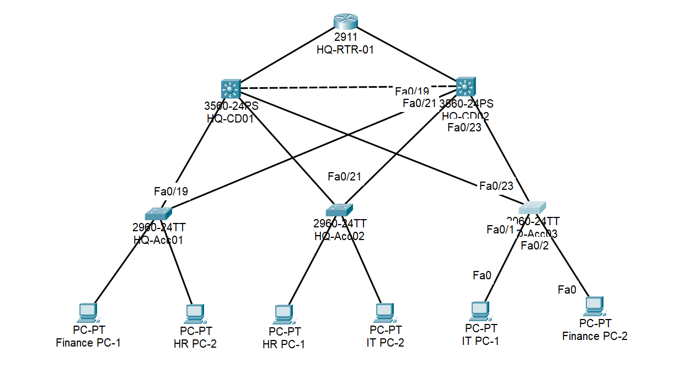

# Lab 01 — HQ Campus Network (Solace Financial Group)

## Objective
Design and configure the headquarters network of a fictional financial organisation, Solace Financial Group (Abuja), with VLAN segmentation, redundant distribution switches, first-hop redundancy and a hardened access layer. This is the foundation that later labs (branches, WAN, security controls, forensics) build on.

## Scenario
Solace Financial Group runs its head office from Abuja and plans to open branches and a data centre. HQ needs separate networks for Finance, HR, IT/Servers, Corporate Wi-Fi, Guest Wi-Fi and Voice, with no single point of failure between users and the router. The whole estate is addressed from `10.0.0.0/8` using VLSM with roughly 2x growth headroom.

## Tools Used
- Cisco Packet Tracer
- Cisco IOS CLI (Catalyst 3560 distribution, 2960 access, ISR 2911 router)

## Topology

| Layer | Devices |
|---|---|
| Edge | HQ-RTR-01 (2911) |
| Distribution | HQ-CD01, HQ-CD02 (3560, Layer 3) |
| Access | HQ-Acc01, HQ-Acc02, HQ-Acc03 (2960), each dual-homed to both distribution switches |

Full addressing, VLAN, HSRP and cabling detail: [addressing-table.md](./addressing-table.md)

## Design Summary
- **VLANs:** 10 Finance, 20 HR, 30 IT/Servers, 40 Corporate Wi-Fi, 50 Guest, 60 Voice, 100 Management, 199 Native (unused), 299 Black_Hole (parking)
- **Trunks:** 802.1Q, native VLAN 199, allowed list `10-60,100,199`
- **Load-balanced HSRP:** CD01 is Active for VLANs 10, 20, 30 and 100 (priority 105 vs 100); CD02 is Active for VLANs 40, 50, 60 (priority 105 vs 100). Preempt is on for every group.
- **Uplink tracking:** each switch tracks its router-facing link (`standby <group> track GigabitEthernet0/x`, default decrement of 10). With only a 5-point gap, losing the router link drops the Active switch 5 below its peer, so the peer takes over. Packet Tracer's 3560 does not accept a custom decrement, so the gap was sized to suit the default.
- **STP:** rapid-PVST, with roots aligned to HSRP Active (CD01 root for 10/20/30/100/199, CD02 root for 40/50/60), so L2 and L3 forwarding paths agree.
- **Routing:** the router reaches HQ subnets through static routes to each distribution switch over routed /30 links; the distribution switches default to the router. Each route has a backup with a higher administrative distance via the other switch, so return traffic still reaches HQ if one router link fails.
- **Management:** VLAN 100 on `10.0.0.248/29`. Switch SVIs `.249`–`.253`, HSRP virtual IP `.254` used as the default gateway by the access switches.

## Hardening Applied
- Unused ports shut down and parked in VLAN 299
- Access ports: sticky port security (max 2), PortFast, BPDU Guard
- Native VLAN moved off VLAN 1; VLAN 1 SVI shut
- `service password-encryption`, `enable secret`, login banners, console and VTY exec-timeout
- Credentials are redacted in the files under `configs/`

## Verification
Screenshots are in [`screenshots/`](./screenshots):

| Check | Evidence |
|---|---|
| VLAN database and port membership | `*-show-vlan-brief.png` |
| Trunks, native VLAN, allowed VLANs, STP forwarding state | `*-show-interfaces-trunk.png` |
| HSRP Active/Standby roles and priorities | `CD01-show-standby-brief.png`, `CD02-show-standby-brief.png` |
| HSRP takeover when a router link fails | `CD02-failover-test-CD01-uplink-down.png`, `CD01-failover-test-CD02-uplink-down.png` |
| Traffic during failover | `Finance-PC1-ping-during-failover.png` |

Result: every VLAN is active on all switches, all uplinks trunk with native VLAN 199, and the HSRP roles match the design (CD01 Active for 10/20/30/100, CD02 Active for 40/50/60).

## Challenges & Fixes
**1. Finance PC could not reach its gateway.** Pings to `10.0.0.1`–`.3` failed even though trunks, VLANs, ARP and HSRP all looked correct. I worked up the stack: interface status, CDP neighbours, MAC tables, trunk output, ARP. The cause was the PC's host firewall, which blocks ICMP by default in Packet Tracer. Turning it off fixed it. Lesson: confirm the endpoint before debugging the network. Full write-up: [`docs/Troubleshooting_Report_Finance_PC.docx`](../../docs/Troubleshooting_Report_Finance_PC.docx).

**2. Missing local (`L`) routes on the 3560.** I considered swapping to 3650s. The 3560's older IOS (12.2) simply does not display `L` routes; connected routes and forwarding are unaffected, so I kept the 3560.

**3. HSRP design choices.** Priorities are independent of VLAN IDs. They only decide which switch is Active per group. Aligning STP roots with the HSRP Active switch avoids traffic crossing the inter-switch link.

## Failover Test — router-link tracking
Baseline: CD01 Active for groups 10, 20, 30, 100; CD02 Active for 40, 50, 60.

| Test | Action | Result |
|---|---|---|
| 1 | Shut `Gig0/1` (router link) on HQ-CD01 | HQ-CD02 became Active for all groups, including 10, 20, 30 and 100 |
| 2 | Shut `Gig0/2` (router link) on HQ-CD02 | HQ-CD01 became Active for all groups, including 40, 50 and 60 |

After `no shutdown` on each link the roles returned to the baseline (preempt). This confirms the 5-point priority gap plus the default 10-point tracking decrement works as designed. A continuous ping (`ping -t 10.0.0.1`) from Finance PC-1 ran during Test 1. It lost 4 packets (21 of 25 received) while the gateway moved to CD02, then replies resumed on their own. That is a gap of a few seconds, in line with HSRP's default hello and hold timers.

## Open Issue — failover when an SVI is shut down
Shutting down `interface vlan 10` on HQ-CD01 makes CD02 take over as HSRP Active for group 10, but Finance traffic still failed. Shutting the physical uplink (`Fa0/20`) instead triggers an STP reconvergence and traffic recovers.

SVIs are Layer 3 interfaces, so shutting one does not change Layer 2 forwarding. Possible contributing factors I am investigating:
- Return traffic from other VLANs still uses CD01 as the gateway for their groups, and CD01's VLAN 10 interface is down, so replies are dropped.
- Packet Tracer HSRP behaviour with the manually set SVI MAC addresses.

Interface tracking (above) covers loss of a router-facing link, not a shut SVI. Next step: ping only the HSRP virtual IP while the SVI is shut, to separate gateway failure from the return-path problem. Result to be added.

## Known Limitations (next commits)
- HSRP timers are at their defaults (3 s hello, 10 s hold). Tuning them would shorten the failover gap and is a candidate for a later commit.
- Router routes are static with floating backups. OSPF is planned to replace them.
- No SSH, local users or AAA yet (VTY uses a line password).
- No ACLs yet (Guest VLAN 50 isolation planned).
- No logging or NTP baseline.
- Branches, Data Centre and WAN links are not built yet.

## Key Takeaways
- Aligning STP roots, HSRP Active roles and trunk allowed lists is what makes a redundant campus design predictable.
- Troubleshooting from the endpoint outwards (host, gateway, ARP, MAC, trunk) found the real fault faster than changing configs.
- Failover has to be tested at the layer where failures actually happen (link or device), not only by shutting a logical interface.

## Files in This Folder
- `topology.png` — network diagram
- `addressing-table.md` — VLANs, subnets, HSRP, device and port map
- `configs/` — running configs (credentials redacted)
- `screenshots/` — verification output
